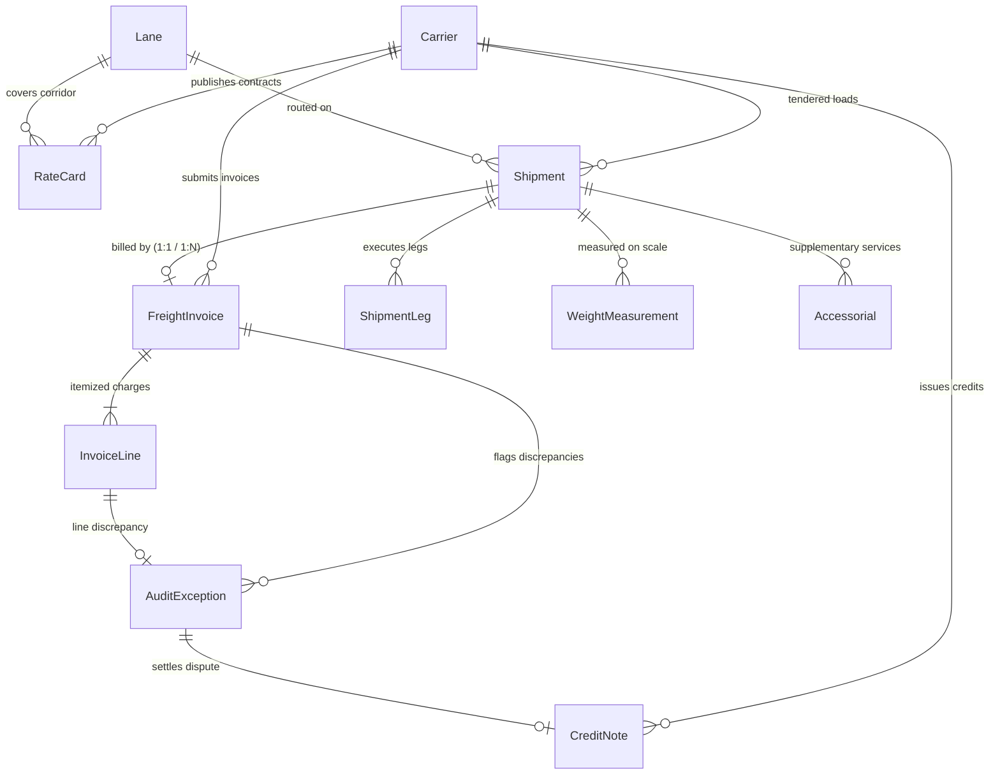
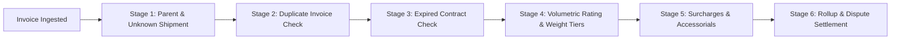

# Freight Invoice Audit Engine & Contract Rating Platform

[]()
[]()
[]()
[]()
[]()
[]()

> An end-to-end commercial freight transportation solution to **validate freight invoices against contracted rates, shipment characteristics, accessorials, and delivery records**, expose key decisions, preserve immutable audit traceability, and reconcile credit disputes.

---

## 📋 Table of Contents
1. [Business Context & Problem Statement](#-business-context--problem-statement)
2. [Primary Actors & Supported Systems](#-primary-actors--supported-systems)
3. [Core Entities & Relational Architecture](#-core-entities--relational-architecture)
4. [Multi-Stage Audit Engine & Rating Logic](#-multi-stage-audit-engine--rating-logic)
5. [Required Edge Cases & Anomaly Injection](#-required-edge-cases--anomaly-injection)
6. [Evaluation Metrics & Benchmark Results](#-evaluation-metrics--benchmark-results)
7. [Quick Start & Execution Guide](#-quick-start--execution-guide)
   - [Environment Setup](#1-environment-setup)
   - [Synthetic Data Generation](#2-synthetic-data-generation)
   - [Reproducibility Verification (Step 10)](#3-reproducibility-verification-step-10)
   - [Running the Test Suite](#4-running-the-test-suite)
   - [Starting the REST API](#5-starting-the-rest-api)
   - [Launching the Interactive Operations Dashboard](#6-launching-the-interactive-operations-dashboard)
8. [Documentation Links](#-documentation-links)

---

## 🎯 Business Context & Problem Statement

Commercial freight invoices frequently diverge from contractual agreements due to:
- **Dimensional Weight Variance**: Differences between physical NTEP scale weight and volumetric cubing.
- **Weight Tier Misapplications**: Billing at baseline rates rather than contracted high-volume discounts.
- **Contract Expiration**: Applying outdated or expired tariff schedules with unauthorized rate spikes.
- **Duplicate Surcharges & Accessorials**: Invoicing twice for DOE diesel fuel or unauthorized liftgate services.
- **Duplicate Invoicing**: Re-billing the same freight shipment on subsequent invoices.
- **Credit Note Over-crediting**: Discrepancies between approved dispute amounts and disbursed credits.

This platform provides an automated, contract-driven, deterministic audit pipeline that intercepts invoice discrepancies before payment disbursement, maintains append-only immutable audit history, and settles disputes via reconciled credit notes.

---

## 👥 Primary Actors & Supported Systems

| Actor / Persona | Operational Role & Responsibilities | System Interface |
| :--- | :--- | :--- |
| **Supplier / Shipper** | Originates commercial orders; defines packaging and legal freight terms. | Bill of Lading (BOL) & ERP |
| **Transportation Planner** | Analyzes lane coverage; tenders shipments under active contracted rate cards. | TMS Tender Portal |
| **Carrier / Warehouse Operator** | Records scale weights and pallet dimensions; presents commercial freight invoices. | EDI 210 / Carrier Invoicing API |
| **Logistics Analyst** | Inspects line-level variances, unauthorized accessorials, and misapplied weight tiers. | Analyst Audit Workbench |
| **Operations Manager** | Sets financial recovery thresholds; approves dispute claims and settles credit notes. | Dispute Settlement Console |

---

## 🏛️ Core Entities & Relational Architecture

The system models **11 core relational entities** plus immutable history events:



1. **Carrier (`Carrier`)**: Master transportation provider (`CAR-000001`).
2. **Lane (`Lane`)**: Master origin-destination freight corridor (`LANE-000001`).
3. **RateCard (`RateCard`)**: Contracted pricing schedule with weight breaks and fuel formulas (`RATE-<carrier-id>-2026-01`).
4. **Shipment (`Shipment`)**: Tendered load with actual NTEP scale & dimensional weights (`SHP-2026-000001`).
5. **ShipmentLeg (`ShipmentLeg`)**: Segment route execution (`LEG-SHP-2026-000001-01`).
6. **WeightMeasurement (`WeightMeasurement`)**: Piece-level scale and cube scan measurements (`WM-2026-000001`).
7. **Accessorial (`Accessorial`)**: Supplementary specialized services like Liftgate, Residential, Hazmat (`ACC-2026-000001`).
8. **FreightInvoice (`FreightInvoice`)**: Commercial billing statement presented by carrier (`FINV-2026-000001`).
9. **InvoiceLine (`InvoiceLine`)**: Itemized line charges summing to invoice total (`FLINE-<invoice-id>-01`).
10. **AuditException (`AuditException`)**: Line-level discrepancy and dispute record (`FEX-2026-000001`).
11. **CreditNote (`CreditNote`)**: Financial refund settling an approved dispute (`CN-2026-000001`).

*Detailed field definitions, allowed values, units, and validation rules are documented in [`docs/DATA_DICTIONARY.md`](docs/DATA_DICTIONARY.md).*

---

## ⚙️ Multi-Stage Audit Engine & Rating Logic



### Volumetric Rating & Weight Tiers
- **Dimensional Weight**:
  $$\text{Dim Weight (lbs)} = \frac{\text{Length (in)} \times \text{Width (in)} \times \text{Height (in)}}{\text{Dim Factor (139)}}$$
- **Billable Weight**:
  $$\text{Billable Weight} = \max(\text{Actual Scale Weight}, \text{Dim Weight})$$
- **Weight Tier Breakdown**:
  - `Tier 1`: $< 500\text{ lbs}$
  - `Tier 2`: $500 - 1,999\text{ lbs}$
  - `Tier 3`: $2,000 - 4,999\text{ lbs}$
  - `Tier 4`: $5,000 - 9,999\text{ lbs}$
  - `Tier 5`: $\ge 10,000\text{ lbs}$
- **Base Freight**:
  $$\text{Base Charge} = \max\left(\text{Base Min Charge},\; \frac{\text{Billable Weight}}{100.0} \times \text{CWT Rate}\right)$$
- **Fuel Surcharge**:
  $$\text{Fuel Surcharge} = \text{round}(\text{Base Charge} \times \text{Fuel Surcharge \%},\; 2)$$
- **Expected Total**:
  $$\text{Expected Total} = \text{Base Charge} + \text{Fuel Surcharge} + \sum \text{Authorized Accessorials}$$

---

## 🧪 Required Edge Cases & Anomaly Injection

All 5 required negative scenarios from the specification plus real-world scenarios are modeled, deterministically injected, and isolated in `ground_truth.csv`/`json`:

| Scenario ID | Edge Case Description | Injection Mechanism | Generated Exception | Severity |
| :--- | :--- | :--- | :--- | :--- |
| **EC-1** | **Invoice references unknown shipment** | Billed with non-existent shipment ID | `UNKNOWN_SHIPMENT` | CRITICAL |
| **EC-2** | **Rate card expired** | Invoiced under expired tariff schedule | `RATE_CARD_EXPIRED` | HIGH |
| **EC-3** | **Weight tier misapplied** | Billed at Tier 1 rate instead of Tier 3 discount | `WEIGHT_TIER_MISAPPLIED` | MEDIUM |
| **EC-4** | **Surcharge duplicated** | Two fuel surcharge lines on the same invoice | `SURCHARGE_DUPLICATED` | HIGH |
| **EC-5** | **Credit note exceeds exception amount** | Half of generated dispute credits match the approved amount; half are twice the derived approved amount and create a separate over-credit exception | `CREDIT_NOTE_EXCEEDS_EXCEPTION` | HIGH |
| **EC-6** | **Duplicate invoice billing** | Same shipment billed twice on separate invoices | `DUPLICATE_INVOICE` | CRITICAL |
| **EC-7** | **Invalid / unauthorized accessorial** | Carrier bills Liftgate without BOL authorization | `INVALID_ACCESSORIAL` | MEDIUM |

---

## 📊 Evaluation Metrics & Benchmark Results

Evaluated against rule-derived labels on the **Full Target Scale (100 carriers, 20,000 shipments, 15,000 invoices)**. These are synthetic acceptance metrics, not estimates of accuracy on real carrier invoices.

| Metric | Target | Achieved | Status |
| :--- | :--- | :--- | :--- |
| **Total Invoices Audited** | 15,000 | **15,000** | **Complete** |
| **Clean Baseline Invoices** | ~11,000 | **10,800** | **Complete** |
| **Exception Invoices** | ~4,200 | **4,200** | **Complete** |
| **Audit Precision** | - | **100.00%** | **All generated invoice labels matched** |
| **Audit Recall** | - | **100.00%** | **All generated invoice labels matched** |
| **Classification F1-Score** | - | **1.0000** | **All generated invoice labels matched** |
| **Overall Classification Accuracy**| - | **100.00%** | **All generated invoice labels matched** |
| **Total Billed Transportation Spend** | - | **\$12,954,220.82** | **Derived from invoice records** |
| **Total Expected Contract Spend** | - | **\$11,812,761.47** | **Recomputed from expected invoice lines** |
| **Total Overcharges Flagged** | - | **\$1,141,459.35** | **Derived from invoice variances** |
| **Credits Issued / Reconciled** | - | **\$57,339.62 / \$23,470.20** | **300 exact; 300 over-credited** |
| **Credit Over-amount** | - | **\$16,934.71** | **Separate over-credit exceptions created** |
| **Reconciled-credit / Overcharge ratio** | - | **2.06%** | **Reconciled credits divided by positive detected overcharges** |
| **Relational and rule validation checks** | - | **59/59 passed** | **PK/FK, dates, rollups, lifecycle, labels, and credits** |
| **Step 10 Full-scale reproducibility** | Identical SHA-256 | **31/31 artifacts; all hashes matched** | **Verified** |

---

## 🚀 Quick Start & Execution Guide

### 1. Environment Setup
```bash
# Clone repository and enter directory
cd freight-invoice-audit

# Install dependencies
pip install -r requirements.txt
```

### 2. Synthetic Data Generation

#### Generate Starter Dataset (400 invoices, 500 shipments)
```bash
python scripts/run_generator.py --scale starter --seed 20261022
```
*Outputs CSV, JSON, and MySQL dump `data/starter/freight_audit_mysql.sql` in ~0.06 seconds.*

#### Generate Full Scale Dataset (15,000 invoices, 20,000 shipments, 100 carriers)
```bash
python scripts/run_generator.py --scale full --seed 20261022
```
*Generates 175,752 relational rows across 11 core entities and two event tables; exports CSV, JSON, SQLite, and a MySQL SQL dump. Live MySQL population is opt-in via `--populate-mysql`.*

#### Direct Ingestion into MySQL Database
```bash
# Using Python MySQL manager:
python scripts/load_to_mysql.py --scale starter --user root --password <your_password> --database freight_audit_db

# Or importing the generated MySQL dump directly:
mysql -u root -p freight_audit_db < data/starter/freight_audit_mysql.sql
```


---

### 3. Reproducibility Verification (Step 10)
```bash
python scripts/verify_reproducibility.py
```
*Generates the starter dataset twice in isolated temporary paths and validates every artifact checksum. Use `--scale full` to verify the 20,000-shipment/15,000-invoice preset.*

---

### 4. Running the Test Suite
```bash
python -m pytest tests/
```
*Executes unit and integration tests across rating algorithms, edge case detection, dispute reconciliation, and data integrity.*

---

### 5. Starting the REST API
```bash
uvicorn freight_audit.api.app:app --host 0.0.0.0 --port 8000 --reload
```
Interactive Swagger documentation available at: `http://localhost:8000/docs`

Available endpoints:
- `GET /health`: System status and loaded dataset statistics
- `POST /audit/invoice`: Ingests a new freight invoice and performs real-time 6-stage audit
- `GET /exceptions`: Lists active audit exceptions with status/severity filters
- `POST /exceptions/{id}/resolve`: Records dispute decision and immutable audit resolution event
- `POST /exceptions/{id}/issue-credit`: Issues credit note and checks reconciliation balance
- `GET /metrics`: Returns precision, recall, F1, accuracy, and financial ROI

---

### 6. Launching the Interactive Operations Dashboard
```bash
streamlit run freight_audit/ui/dashboard.py
```
Provides:
- **Invoice Audit Workbench**: Drill-down into line-level expected vs. billed breakdowns.
- **Exception Dispute Console**: Logistics Analyst & Operations Manager settlement actions.
- **Anomaly Coverage & Metrics**: Precision, recall, and overcharge recovery charts.
- **Contract & Rate Card Explorer**: Tariffs, CWT weight breaks, and lane distance maps.

---

## 📚 Documentation Links
- [`docs/DATA_DICTIONARY.md`](docs/DATA_DICTIONARY.md): Complete data dictionary for all 11 entities (field types, allowed values, units, validation rules).
- [`docs/ARCHITECTURE.md`](docs/ARCHITECTURE.md): Technical workflows, actor personas, and state lifecycle machines.
- [`docs/VALIDATION_REPORT.md`](docs/VALIDATION_REPORT.md): Relational integrity checks (59/59), arithmetic verification, and SHA-256 proofs.
- [`docs/SOURCE_MANIFEST.md`](docs/SOURCE_MANIFEST.md): Seed documentation, parameter presets, and lawful provenance.
