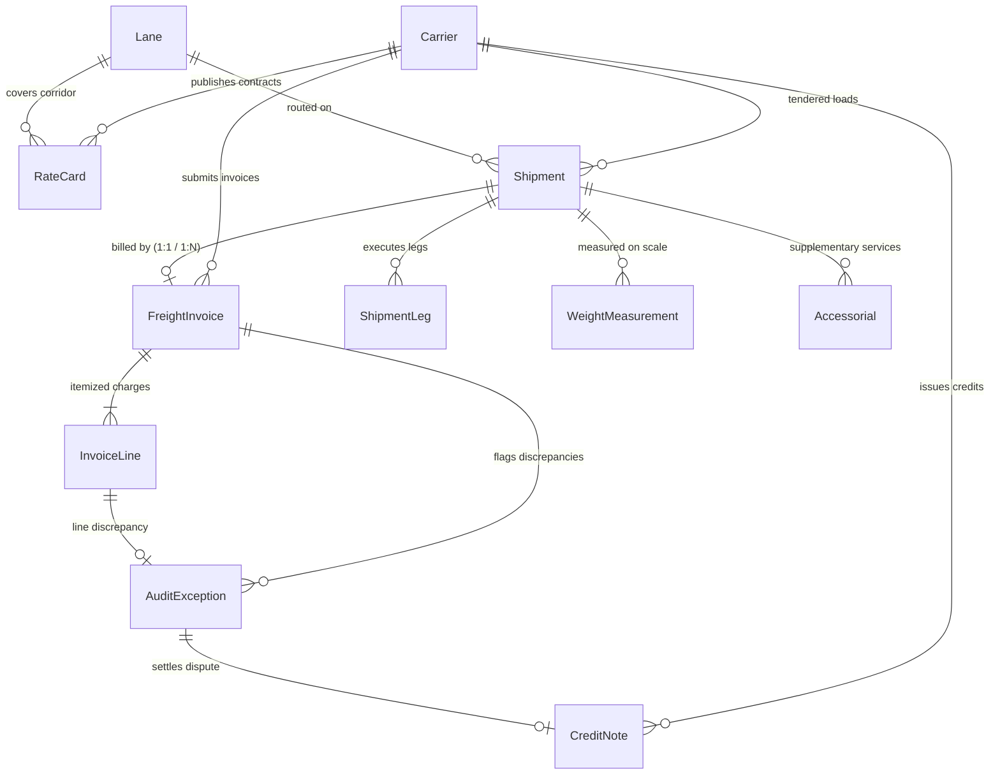
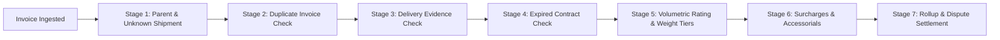

# Freight Invoice Audit Engine & Contract Rating Platform


> An end-to-end commercial freight transportation solution to **validate freight
> invoices against contracted rates, shipment characteristics, accessorials, and
> delivery records**, expose key decisions, preserve immutable audit
> traceability, and reconcile credit disputes.

---

## 📋 Table of Contents

1. [Business Context & Problem Statement](#-business-context--problem-statement)
2. [Primary Actors & Supported Systems](#-primary-actors--supported-systems)
3. [Core Entities and Relational Architecture](#core-entities-and-relational-architecture)
4. [Multi-Stage Audit Engine and Rating Logic](#multi-stage-audit-engine-and-rating-logic)
5. [Required Edge Cases & Anomaly Injection](#-required-edge-cases--anomaly-injection)
6. [Evaluation Metrics & Benchmark Results](#-evaluation-metrics--benchmark-results)
7. [Quick Start & Execution Guide](#-quick-start--execution-guide)
   - [Environment Setup](#1-environment-setup)
   - [Synthetic Data Generation](#2-synthetic-data-generation)
   - [Reproducibility Verification (Step 10)](#3-reproducibility-verification-step-10)
   - [Running the Test Suite](#4-running-the-test-suite)
   - [Starting the REST API](#5-starting-the-rest-api)
   - [Launching the Interactive Operations Dashboard](#6-launching-the-interactive-operations-dashboard)
8. [Documentation Links](#-documentation-links)

---

## 🎯 Business Context & Problem Statement

Commercial freight invoices frequently diverge from contractual agreements due
to:

- **Dimensional Weight Variance**: Differences between physical NTEP scale
  weight and volumetric cubing.
- **Weight Tier Misapplications**: Billing at baseline rates rather than
  contracted high-volume discounts.
- **Contract Expiration**: Applying outdated or expired tariff schedules with
  unauthorized rate spikes.
- **Duplicate Surcharges & Accessorials**: Invoicing twice for DOE diesel fuel
  or unauthorized liftgate services.
- **Duplicate Invoicing**: Re-billing the same freight shipment on subsequent
  invoices.
- **Credit Note Over-crediting**: Discrepancies between approved dispute amounts
  and disbursed credits.

This platform provides an automated, contract-driven, deterministic audit
pipeline that intercepts invoice discrepancies before payment disbursement,
maintains append-only immutable audit history, and settles disputes via
reconciled credit notes.

---

## 👥 Primary Actors & Supported Systems

- **Supplier / Shipper**: Creates orders and sets packaging and freight terms.
  **System**: Bill of Lading (BOL) and ERP.
- **Transportation Planner**: Selects contracted carriers and tenders shipments.
  **System**: TMS tender portal.
- **Carrier / Warehouse Operator**: Records weights and dimensions, then submits
  freight invoices. **System**: EDI 210 and carrier invoicing API.
- **Logistics Analyst**: Reviews line variances, accessorials, and weight tiers.
  **System**: Audit workbench.
- **Operations Manager**: Approves disputes and oversees credit settlement.
  **System**: Dispute settlement console.

---

## Core Entities and Relational Architecture

The system models **11 core relational entities** plus immutable history events:



1. **Carrier (`Carrier`)**: Master transportation provider (`CAR-000001`).
2. **Lane (`Lane`)**: Master origin-destination freight corridor
   (`LANE-000001`).
3. **RateCard (`RateCard`)**: Contracted pricing schedule with weight breaks and
   fuel formulas (`RATE-<carrier-id>-2026-01`).
4. **Shipment (`Shipment`)**: Tendered load with actual NTEP scale & dimensional
   weights (`SHP-2026-000001`).
5. **ShipmentLeg (`ShipmentLeg`)**: Segment route execution
   (`LEG-SHP-2026-000001-01`).
6. **WeightMeasurement (`WeightMeasurement`)**: Piece-level scale and cube scan
   measurements (`WM-2026-000001`).
7. **Accessorial (`Accessorial`)**: Supplementary specialized services like
   Liftgate, Residential, Hazmat (`ACC-2026-000001`).
8. **FreightInvoice (`FreightInvoice`)**: Commercial billing statement presented
   by carrier (`FINV-2026-000001`).
9. **InvoiceLine (`InvoiceLine`)**: Itemized line charges summing to invoice
   total (`FLINE-<invoice-id>-01`).
10. **AuditException (`AuditException`)**: Line-level discrepancy and dispute
    record (`FEX-2026-000001`).
11. **CreditNote (`CreditNote`)**: Financial refund settling an approved dispute
    (`CN-2026-000001`).

_Detailed field definitions, allowed values, units, and validation rules are
documented in [`docs/DATA_DICTIONARY.md`](docs/DATA_DICTIONARY.md)._

---

## Multi-Stage Audit Engine and Rating Logic



The audit verifies completed shipment-leg delivery evidence for every matched
shipment. When an invoice supplies `billed_delivery_date`, it is also compared
with the shipment and completed leg dates. The API accepts this value as an ISO
date; synthetic invoices include the recorded date. Missing or conflicting
delivery evidence raises a `DELIVERY_DATE_MISMATCH` exception.

### Volumetric Rating & Weight Tiers

- **Dimensional weight (lbs)**: `(length × width × height) / dim factor (139)`.
- **Billable weight**: `max(actual scale weight, dimensional weight)`.
- **Weight tiers**: Tier 1 is `< 500 lbs`; Tier 2 is `500–1,999 lbs`; Tier 3 is
  `2,000–4,999 lbs`; Tier 4 is `5,000–9,999 lbs`; Tier 5 is `>= 10,000 lbs`.
- **Base freight**: `max(minimum charge, billable weight / 100 × CWT rate)`.
- **Fuel surcharge**: `round(base charge × contracted fuel percentage, 2)`.
- **Expected total**: Base freight + fuel surcharge + authorized accessorials.

---

## 🧪 Required Edge Cases & Anomaly Injection

All 5 required negative scenarios from the specification plus real-world
scenarios are modeled, deterministically injected, and isolated in
`ground_truth.csv`/`json`:

- **EC-1 — Unknown shipment**: Invoice references a nonexistent shipment.
  **Exception**: `UNKNOWN_SHIPMENT` (critical).
- **EC-2 — Expired rate card**: Invoice claims an expired tariff. **Exception**:
  `RATE_CARD_EXPIRED` (high).
- **EC-3 — Misapplied weight tier**: Tier 1 rate is used instead of Tier 3.
  **Exception**: `WEIGHT_TIER_MISAPPLIED` (medium).
- **EC-4 — Duplicate surcharge**: Two fuel surcharges appear on one invoice.
  **Exception**: `SURCHARGE_DUPLICATED` (high).
- **EC-5 — Excess credit**: Half of generated credits match the approved amount;
  half are twice the approved amount and create an over-credit exception.
  **Exception**: `CREDIT_NOTE_EXCEEDS_EXCEPTION` (high).
- **EC-6 — Duplicate invoice**: The same shipment is billed on separate
  invoices. **Exception**: `DUPLICATE_INVOICE` (critical).
- **EC-7 — Unauthorized accessorial**: Liftgate is billed without BOL approval.
  **Exception**: `INVALID_ACCESSORIAL` (medium).

---

## 📊 Evaluation Metrics & Benchmark Results

Evaluated against rule-derived labels on the **Full Target Scale (100 carriers,
20,000 shipments, 15,000 invoices)**. These are synthetic acceptance metrics,
not estimates of accuracy on real carrier invoices.

- **Invoices audited**: 15,000 (target: 15,000).
- **Clean baseline invoices**: 10,800 (target: approximately 11,000).
- **Exception invoices**: 4,200 (target: approximately 4,200).
- **Precision / recall**: 100% / 100%; all generated invoice labels matched.
- **Classification F1 / accuracy**: 1.0000 / 100%.
- **Total billed spend**: $12,954,220.82, derived from invoice records.
- **Expected contract spend**: $11,812,761.47, derived from invoice lines.
- **Overcharges flagged**: $1,141,459.35, derived from invoice variances.
- **Credits issued / reconciled**: $57,339.62 / $23,470.20. This includes 300
  exact and 300 over-credited notes.
- **Credit over-amount**: $16,934.71, with separate over-credit exceptions.
- **Reconciled-credit / overcharge ratio**: 2.06%. This is reconciled credits
  divided by positive detected overcharges.
- **Relational and rule validation**: 60/60 checks passed.
- **Full-scale reproducibility**: All 31 artifacts matched by SHA-256.

---

## 🚀 Quick Start & Execution Guide

### 1. Environment Setup

```bash
# Clone repository and enter directory
cd freight-invoice-audit

# Install dependencies
pip install -r requirements.txt
```

### 2. Synthetic Data Generation

#### Generate Starter Dataset (400 invoices, 500 shipments)

```bash
python scripts/run_generator.py --scale starter --seed 20261022
```

_Outputs CSV, JSON, and MySQL dump `data/starter/freight_audit_mysql.sql` in
~0.06 seconds._

#### Generate Full Scale Dataset (15,000 invoices, 20,000 shipments, 100 carriers)

```bash
python scripts/run_generator.py --scale full --seed 20261022
```

_Generates 175,752 relational rows across 11 core entities and two event tables;
exports CSV, JSON, SQLite, and a MySQL SQL dump. Live MySQL population is opt-in
via `--populate-mysql`._

#### Direct Ingestion into MySQL Database

```bash
# Using Python MySQL manager:
python scripts/load_to_mysql.py --scale starter --user root --password \
  <your_password> --database freight_audit_db

# Or importing the generated MySQL dump directly:
mysql -u root -p freight_audit_db < data/starter/freight_audit_mysql.sql
```

---

### 3. Reproducibility Verification (Step 10)

```bash
python scripts/verify_reproducibility.py
```

_Generates the starter dataset twice in isolated temporary paths and validates
every artifact checksum. Use `--scale full` to verify the
20,000-shipment/15,000-invoice preset._

---

### 4. Running the Test Suite

```bash
python -m pytest tests/
```

_Executes unit and integration tests across rating algorithms, edge case
detection, dispute reconciliation, and data integrity._

---

### 5. Starting the REST API

```bash
uvicorn freight_audit.api.app:app --host 0.0.0.0 --port 8000 --reload
```

Interactive Swagger documentation available at: `http://localhost:8000/docs`

Runtime invoice submissions, exception decisions, credits, and their history
events persist in a separate SQLite journal under `.state/`. The deterministic
baseline is regenerated on startup and the journal is reapplied. Set
`FREIGHT_AUDIT_STATE_DB` to override the API journal path. The dashboard
persists its workflow data in a journal isolated by selected scale and seed.

Available endpoints:

- `GET /health`: System status and loaded dataset statistics
- `POST /audit/invoice`: Ingests a new freight invoice and performs real-time
  6-stage audit
- `GET /exceptions`: Lists active audit exceptions with status/severity filters
- `POST /exceptions/{id}/resolve`: Records dispute decision and immutable audit
  resolution event
- `POST /exceptions/{id}/issue-credit`: Issues credit note and checks
  reconciliation balance
- `GET /metrics`: Returns precision, recall, F1, accuracy, and financial ROI

---

### 6. Launching the Interactive Operations Dashboard

```bash
streamlit run freight_audit/ui/dashboard.py
```

Provides:

- **Invoice Audit Workbench**: Drill-down into line-level expected vs. billed
  breakdowns.
- **Exception Dispute Console**: Logistics Analyst & Operations Manager
  settlement actions.
- **Anomaly Coverage & Metrics**: Precision, recall, and overcharge recovery
  charts.
- **Contract & Rate Card Explorer**: Tariffs, CWT weight breaks, and lane
  distance maps.

---

## 📚 Documentation Links

- [`docs/DATA_DICTIONARY.md`](docs/DATA_DICTIONARY.md): Complete data dictionary
  for all 11 entities (field types, allowed values, units, validation rules).
- [`docs/ARCHITECTURE.md`](docs/ARCHITECTURE.md): Technical workflows, actor
  personas, and state lifecycle machines.
- [`docs/VALIDATION_REPORT.md`](docs/VALIDATION_REPORT.md): Relational integrity
  checks (60/60), arithmetic verification, and SHA-256 proofs.
- [`docs/SOURCE_MANIFEST.md`](docs/SOURCE_MANIFEST.md): Seed documentation,
  parameter presets, and lawful provenance.
