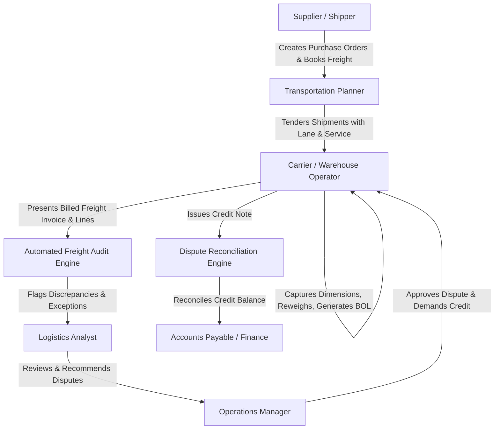
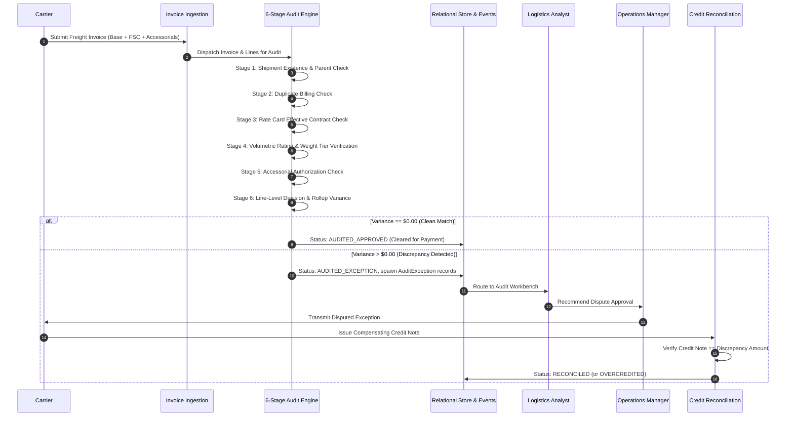

# Freight Invoice Audit Engine — Architecture & System Design

## 1. System Overview & Business Context

The Freight Invoice Audit Engine automates the verification, rating, dispute management, and settlement of commercial freight transportation invoices. Billed transportation charges frequently diverge from contracted tariffs due to:
- Dimensional weight (volumetric weight) vs. actual scale weight differences
- Weight-break tier misapplications
- Expired or superseded rate cards
- Duplicate billing across multiple invoices
- Unrequested or unauthorized accessorial service fees (e.g. liftgate, residential delivery, inside delivery)
- Surcharge miscalculations (e.g. DOE diesel fuel index discrepancies)
- Phantom invoices referencing non-existent shipments

The solution guarantees **end-to-end traceability**, **immutable event logging**, **deterministic multi-stage audit decisions**, and **arithmetic dispute reconciliation**.

---

## 2. Primary Actors & Personas



1. **Supplier / Shipper**: Originates commercial goods; defines standard packaging and freight terms.
2. **Transportation Planner**: Evaluates carrier lane coverage and service tiers; selects contracted carriers for tender.
3. **Carrier / Warehouse Operator**: Executes pickup and line-haul transit; scans NTEP-calibrated scale weights and pallet cube dimensions; issues commercial freight invoices.
4. **Logistics Analyst**: Investigates line-level charge variances, rate tier mismatches, and unauthorized accessorials; drafts dispute rationales.
5. **Operations Manager**: Authorizes settlement thresholds, approves carrier disputes, and oversees credit note reconciliation.

---

## 3. End-to-End Workflow & Multi-Stage Audit Rules



### The 6 Audit Stages

1. **Stage 1: Parent & Entity Existence Check**
   - Validates that the resolved `invoice.shipment_id` exists; an unresolved external ID is retained in `shipment_reference`.
   - Failure condition: Unmatched or phantom shipment generates `UNKNOWN_SHIPMENT` exception (Severity: CRITICAL).
2. **Stage 2: Duplicate Billing Check**
   - Checks both `(carrier_id, shipment_id)` and `(carrier_id, invoice_number)`.
   - Failure condition: Re-billing an already processed shipment generates `DUPLICATE_INVOICE` exception (Severity: CRITICAL).
3. **Stage 3: Contract Rate Card Validity Check**
   - Evaluates active contracted rate cards by carrier, lane, service level, and tender date.
   - Failure condition: Inactive or expired rate card generates `RATE_CARD_EXPIRED` exception (Severity: HIGH).
4. **Stage 4: Characteristics & Volumetric Rating Verification**
   - Calculates dimensional weight = `(Length * Width * Height) / Dim_Factor`.
   - Billable weight = `max(Actual_Scale_Weight, Dim_Weight)`.
   - Determines appropriate weight tier (Tier 1 to 5).
   - Computes expected base charge = `max(Base_Min_Charge, (Billable_Weight / 100.0) * Tier_Rate)`.
   - Failure condition: Discrepancy > $1.00 generates `WEIGHT_TIER_MISAPPLIED` or `BASE_RATE_MISMATCH`.
5. **Stage 5: Surcharges & Accessorials Verification**
   - Fuel Surcharge: Compares billed FSC against `round(base_charge * contracted_fsc_pct, 2)`. Duplicate fuel lines flag `SURCHARGE_DUPLICATED`.
   - Accessorials: Validates whether billed accessorial code was requested and authorized on the Bill of Lading. Unauthorized accessorials flag `INVALID_ACCESSORIAL`.
6. **Stage 6: Exception Resolution & Credit Note Reconciliation**
   - Approved disputes require matching credit notes from carriers.
   - Arithmetic balance check:
     $$\text{Balance} = \text{Credit\_Amount} - \text{Discrepancy\_Amount}$$
     - Balance $= 0$: `RECONCILED`
     - Balance $> 0$: `OVERCREDITED` (triggers `CREDIT_NOTE_EXCEEDS_EXCEPTION`)
     - Balance $< 0$: `UNDERCREDITED`

---

## 4. Entity Lifecycle State Machines

### 4.1 Freight Invoice Lifecycle
```
[PENDING_AUDIT] 
       │
       ├──(Variance == 0)──────────────> [AUDITED_APPROVED] ──> [PAID]
       │
       └──(Exceptions Raised)──────────> [AUDITED_EXCEPTION]
                                                 │
                                                 ├──(Dispute Initiated)──> [DISPUTED]
                                                 │                             │
                                                 │                             ├──(Credit Issued)──> [PAID (Net)]
                                                 │                             └──(Rejected)───────> [REJECTED]
                                                 └──(Overruled)──────────> [AUDITED_APPROVED]
```

### 4.2 Audit Exception Lifecycle
```
[OPEN] ──> [UNDER_REVIEW] ──┬──> [APPROVED_DISPUTE] ──> [RESOLVED (Credit Applied)]
                            └──> [REJECTED_DISPUTE] ──> [RESOLVED (No Credit)]
```

### 4.3 Credit Note Lifecycle
```
[PENDING_CARRIER] ──> [APPLIED] ──┬──(Credit == Exception)──> [RECONCILED]
                                   ├──(Credit > Exception)───> [OVERCREDITED]
                                   └──(Credit < Exception)───> [UNDERCREDITED]
```

---

## 5. Traceability & Immutable History

To prevent audit tampering and maintain complete SOX/financial compliance:
- Every state change writes an explicit record to `invoice_status_events` or `audit_resolution_events`.
- Prior state records are never updated in-place; state changes are strictly append-only.
- All records record `changed_by`, `reason`, `timestamp`, and the state transition tuple `(from_status, to_status)`.
- Every generated invoice has an invoice-status event, and every resolved exception has a resolution event.
- An unknown external shipment reference is kept in `FreightInvoice.shipment_reference` while
  `shipment_id` remains null, preserving the raw anomaly without creating a broken FK.
- Rate-card IDs and authorized accessorial IDs are stored on their dependent shipment, invoice,
  and line records so rating and authorization decisions can be traced through exact joins.
